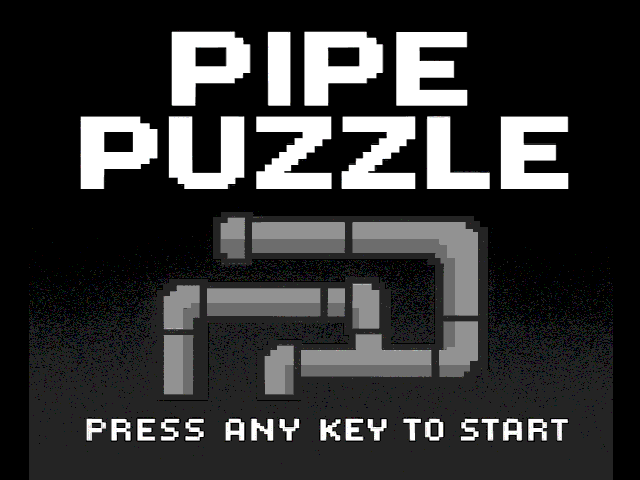

# FPGA Pipe Puzzle

A three-level pipe puzzle built in Verilog for the **DE1-SoC**. Rotate tiles on a 4×4 grid to connect the water source to the outlet without leaks. The game uses a PS/2 keyboard, a 640×480 VGA display, and the board's seven-segment displays to show elapsed time for each level.

**Jenson Liang and Mingju Sun** · ECE241 · University of Toronto · Fall 2025

## Controls

| Input | Action |
| --- | --- |
| Any PS/2 key | Start from the title screen |
| W / A / S / D | Move the selected tile up / left / down / right |
| Space | Rotate the selected pipe |
| R | Reset the current puzzle and its timer |
| KEY[0] on the DE1-SoC | Restart from level 1 |

## Repository layout

| Path | Contents |
| --- | --- |
| [rtl/pipe_puzzle_game.v](rtl/pipe_puzzle_game.v) | Top-level module and level progression |
| [rtl/game/](rtl/game/) | Pipe orientations, water flow, leak and win detection, and the timer |
| [rtl/input/](rtl/input/) | PS/2 keyboard interface |
| [rtl/video/](rtl/video/) | Game renderer and the VGA adapter, controller, address translator, and PLL |
| [quartus/](quartus/) | Quartus project, DE1-SoC pin assignments, and the title-screen memory image |
| [docs/](docs/) | Title-screen preview rendered from the original memory image |

The keyboard decoder supplies the selected tile and rotation command. The pipe manager uses a 32-bit LFSR to randomize initial orientations, then tracks which pipes are connected to the source and where they leak. The VGA renderer uses those signals to draw the board, and the timer stops counting when a level is solved.

## Build and run

1. Install Quartus Prime Lite with Cyclone V device support. The project settings are based on Quartus Prime Lite 18.1.
2. Open [quartus/pipe_puzzle_game.qpf](quartus/pipe_puzzle_game.qpf) and run **Processing → Start Compilation**. The top-level entity is `pipe_puzzle_game`, and the target device is `5CSEMA5F31C6`.
3. Connect the VGA monitor and PS/2 keyboard to the DE1-SoC. In Quartus Programmer, select USB-Blaster and load `quartus/output_files/pipe_puzzle_game.sof` over JTAG.

## Credits

- The ECE241 teaching team provided the modules in [rtl/video/vga_adapter/](rtl/video/vga_adapter/).
- The keyboard interface was adapted from Professor Stephen Brown's `ps2_demo.v`.
